<div align="center">
<h1>👾 Olá, eu sou <b>Henry</b> 👾</h1>
<h3><code>INSERT COIN TO START</code> 🕹️</h3>

</div>
<hr>
## 🟡 PLAYER 1 — Perfil
 
```text
╔══════════════════════════════════╗
║  NOME ........ Henry             ║
║  CLASSE ...... Desenvolvedor     ║
║  BASE ........ São Paulo, BR     ║
║  VIDAS ....... ❤️❤️❤️            ║
║  PONTOS ...... ∞                 ║
╚══════════════════════════════════╝
```
 
- 🔭 Atualmente trabalhando em: **Cell Go**
- 🌱 Aprendendo: **Análise e Desenvolvimento de Sistemas**
- 💬 Pergunte-me sobre: **HTML, Git e GitHub**
- 📫 Fale comigo: **goncalveshenry94@gmail.com**
<hr>
## 🍒 POWER-UPS (Skills)
 
<div align="center">

</div>
<hr>
## 🎮 O JOGO: Pac-Man das minhas contribuições
 
O Pac-Man come os "pontinhos" do meu gráfico de contribuições. Quanto mais eu commito, mais pontos ele tem para comer, e os fantasmas ficam de olho! 👻
 
<div align="center">
<picture>
  <source media="(prefers-color-scheme: dark)" srcset="https://raw.githubusercontent.com/henrygoncalves1110-arch/henrygoncalves1110-arch/output/pacman-contribution-graph-dark.svg">
  <source media="(prefers-color-scheme: light)" srcset="https://raw.githubusercontent.com/henrygoncalves1110-arch/henrygoncalves1110-arch/output/pacman-contribution-graph.svg">
  
</picture>
</div>
<hr>
## 🏆 HIGH SCORES (Estatísticas)
 
<div align="center">


</div>
<hr>
## 🕹️ FASES (Projetos em destaque)
 
| Fase | Projeto | Descrição | Tech |
|:----:|---------|-----------|------|
| 1️⃣ | [Santo-Taquito](https://github.com/henrygoncalves1110-arch/Santo-Taquito) | Site para um restaurante de comida mexicana | `HTML` |
| 2️⃣ | [Cell-Go](https://github.com/henrygoncalves1110-arch/CellGO) | Projeto de uma empresa que vende e revende celulares | `SQL` |
 
<hr>
## 📡 CONECTE-SE
 
<div align="center">
<a href="https://github.com/henrygoncalves1110-arch"></a>
<a href="mailto:goncalveshenry94@gmail.com"></a>
<h3><code>GAME OVER? NÃO. CONTINUE? ▶ SIM</code> 👾</h3>
</div>
 
